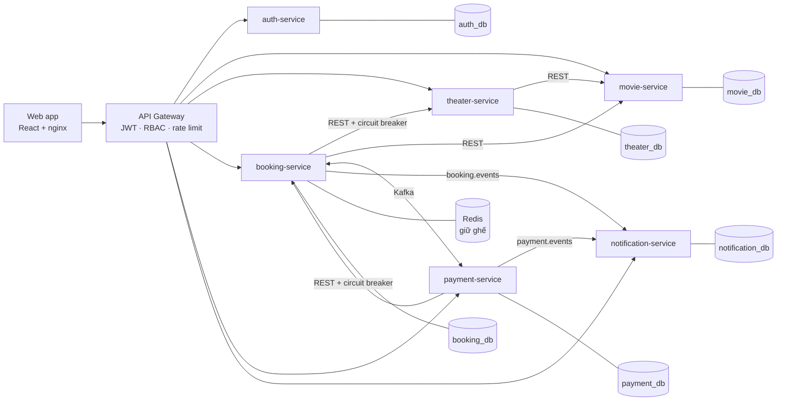
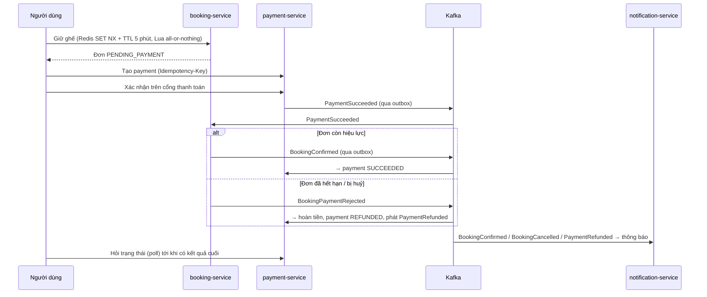

# CineBook – Hệ thống đặt vé xem phim theo kiến trúc Microservices

Dự án cá nhân mô phỏng một nền tảng đặt vé xem phim: chọn phim → chọn suất → giữ ghế theo thời gian thực → thanh toán → nhận vé và thông báo. Trọng tâm là các bài toán của hệ thống phân tán: **giữ ghế không trùng**, **giao dịch xuyên service bằng Saga**, **không mất sự kiện** (Transactional Outbox), **xử lý trùng lặp** (idempotent consumer), **xác thực tập trung** ở API Gateway.

**Công nghệ:** Java 21 · Spring Boot 4 · Spring Cloud Gateway · Apache Kafka (KRaft) · PostgreSQL · Redis · Resilience4j · React 19 + TypeScript + Vite · Docker Compose · Testcontainers

---

## Chạy nhanh (một lệnh)

Yêu cầu: Docker Desktop (khuyến nghị cấp ≥ 6 GB RAM cho Docker).

```bash
cp .env.example .env
docker compose up -d --build
```

Lần đầu build mất vài phút (tải dependency Maven/npm). Khi `docker compose ps` báo các service `healthy`:

| | Địa chỉ |
|---|---|
| Web | http://localhost:3000 |
| API Gateway | http://localhost:8080 |
| Kafka UI (tuỳ chọn) | `docker compose --profile tools up -d kafka-ui` → http://localhost:8090 |

**Tài khoản demo**

| Vai trò | Email | Mật khẩu |
|---|---|---|
| Khách hàng | `demo@cinebook.vn` | `Demo@123` |
| Quản trị | `admin@cinebook.vn` | `Admin@123` |

Dữ liệu mẫu được tạo tự động: phim, rạp, phòng, ghế và **suất chiếu đang mở bán cho 7 ngày tới** (theater-service tạo lại mỗi lần khởi động nếu còn thiếu). Kịch bản demo 5 phút: [docs/demo-script.md](docs/demo-script.md).

Dừng: `docker compose down` (thêm `-v` để xoá dữ liệu).

---

## Kiến trúc



| Service | Cổng | Trách nhiệm |
|---|---|---|
| api-gateway | 8080 | Định tuyến, xác thực JWT (RS256 qua JWKS), phân quyền `/api/admin/**`, xoá header danh tính giả mạo, rate limit, correlation id |
| auth-service | 8086 | Đăng ký/đăng nhập, cấp access token + refresh token (rotation), quản trị người dùng |
| movie-service | 8081 | Danh mục phim, thể loại, upload media (Cloudinary) |
| theater-service | 8082 | Rạp, phòng, sơ đồ ghế, suất chiếu (chống trùng lịch bằng exclusion constraint) |
| booking-service | 8083 | Giữ ghế (Redis), vòng đời đơn vé, Saga phía booking, thống kê admin |
| payment-service | 8084 | Thanh toán (cổng giả lập), Saga phía payment, hoàn tiền bù trừ |
| notification-service | 8085 | Tạo thông báo cho người dùng từ sự kiện Kafka |

Mỗi service có **database riêng**, không có khoá ngoại hay truy vấn chéo giữa các database.

## Luồng đặt vé (Saga choreography)



Danh mục topic và payload sự kiện: [docs/events.md](docs/events.md).

## Các quyết định thiết kế & đánh đổi

- **Saga choreography thay vì orchestration:** chỉ có 2 bên tham gia chính (booking ↔ payment) nên phát/nghe sự kiện trực tiếp đơn giản hơn một orchestrator riêng. Nếu luồng có thêm bước (voucher, điểm thưởng…) thì nên chuyển sang orchestration để dễ theo dõi.
- **Transactional Outbox + poller:** sự kiện được ghi vào bảng `outbox_events` trong cùng transaction với thay đổi nghiệp vụ, sau đó poller đẩy lên Kafka (`FOR UPDATE SKIP LOCKED`). Đánh đổi: độ trễ ~0,5 s và cần dọn bảng outbox; đổi lại không bao giờ mất sự kiện khi service sập giữa chừng.
- **Idempotent consumer:** mỗi consumer ghi `processed_events(event_id, consumer)` trong cùng transaction; Kafka giao lại cũng không xử lý hai lần. Lỗi dữ liệu đẩy thẳng sang `*.DLT`, lỗi tạm thời retry 3 lần.
- **Giữ ghế bằng Redis, nguồn sự thật ở Postgres:** Redis chặn tranh chấp nhanh; unique index trên `booking_seats` là chốt chặn cuối.
- **Snapshot thông tin hiển thị trong booking:** lưu tên phim/rạp/giờ chiếu lúc giữ ghế để trang admin không phải gọi chéo service cho từng dòng, và vé không đổi khi dữ liệu nguồn đổi.
- **Chỉ gateway verify JWT:** service phía sau tin `X-User-Id` do gateway gắn, và chỉ nhận request có `X-Gateway-Secret`. Đơn giản cho dự án; môi trường thật nên thêm mTLS/mạng nội bộ hoặc để từng service tự verify JWT.
- **Circuit breaker** cho lời gọi REST đồng bộ còn lại (booking→theater, payment→booking) để service đích chết thì lỗi nhanh 503 thay vì treo.

**Giới hạn hiện tại:** cổng thanh toán là giả lập; admin chưa hoàn tiền thủ công cho đơn đã thanh toán; chưa có tracing phân tán/dashboard metrics; chưa có job dọn bảng outbox.

---

## Phát triển bằng IDE

Chỉ chạy hạ tầng bằng Docker, các service chạy trong IDE:

```bash
docker compose -f backend/infra/docker-compose.yml up -d
```

Mỗi service là một project Maven độc lập trong `backend/<service>/<module>`; cấu hình mặc định trỏ tới `localhost`. Frontend:

```bash
cd web-app && npm install && npm run dev   # http://localhost:5173, proxy /api → gateway 8080
```

Bật suất chiếu demo khi chạy theater-service trong IDE: đặt biến môi trường `DEMO_SEED=true`.

## Kiểm thử

```bash
cd backend/booking-service/booking && ./mvnw test     # các service khác: mvn test
```

Test tích hợp dùng **Testcontainers** (PostgreSQL thật) cho Saga, outbox, idempotency, API admin, xác thực và luật bảo mật của gateway — cần Docker đang chạy.

Collection API (Bruno): thư mục [api-collection/](api-collection) — mở bằng Bruno, chọn environment `local`.

## Cấu hình

Biến môi trường nằm trong `.env` (xem `.env.example`, file `.env` không được commit): `GATEWAY_SECRET`, `BOOKING_SERVICE_KEY`, mật khẩu demo, `DEMO_SEED`, và `CLOUDINARY_*` (tuỳ chọn – chỉ cần cho chức năng upload ảnh của admin).

> Lưu ý bảo mật: các phiên bản trước của repo có chứa khoá Cloudinary trong `application.yaml`. Khoá đó cần được thu hồi/tạo mới trên Cloudinary; cấu hình hiện tại chỉ đọc từ biến môi trường.
