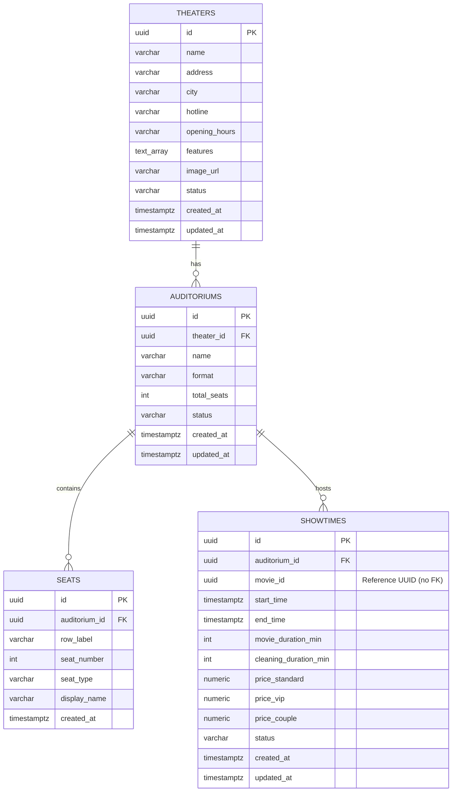

# Kế Hoạch Kỹ Thuật Chi Tiết — theater-service

> **Dự án**: CineBook Microservice Architecture  
> **Microservice**: `theater-service`  
> **Cổng dịch vụ**: `8082` | **Database**: `theater_db` (PostgreSQL - Port `5434`)  
> **Vị trí trong Roadmap**: `movie-service` → **`theater-service`** → `booking-service` → Redis seat hold → `payment-service` → Kafka/Saga

---

## 1. Mục Tiêu & Phạm Vi (Scope)

`theater-service` chịu trách nhiệm quản trị và cung cấp toàn bộ dữ liệu vật lý về rạp chiếu, phòng chiếu, cấu trúc sơ đồ ghế và lịch chiếu phim (Showtimes):
- Cung cấp dữ liệu nền tảng cho `booking-service` (suất chiếu, phòng, ghế) để phục vụ luồng đặt vé và giữ ghế Redis.
- Thực hiện xác thực chéo (cross-service validation) với `movie-service` bằng `RestClient` (lấy duration, kiểm tra movie tồn tại).
- Đảm bảo toàn vẹn dữ liệu thông qua các ràng buộc nghiệp vụ: kiểm tra trùng lịch chiếu (Showtime Overlap), tên phòng duy nhất trong rạp, vị trí ghế duy nhất trong phòng.

---

## 2. Thiết Kế Cơ Sở Dữ Liệu Chi Tiết (Database Schema)

### 2.1. Sơ đồ Quan Hệ Thực Thể (ERD)



---

### 2.2. Chi Tiết Bảng & Ràng Buộc (DDL Specification)

#### Bảng `theaters` (Cụm rạp)
| Cột | Kiểu Dữ Liệu | Ràng Buộc | Mô Tả |
| :--- | :--- | :--- | :--- |
| `id` | `UUID` | `PRIMARY KEY DEFAULT gen_random_uuid()` | Định danh cụm rạp |
| `name` | `VARCHAR(255)` | `NOT NULL` | Tên cụm rạp (VD: CineBook Landmark 81) |
| `address` | `VARCHAR(500)` | `NOT NULL` | Địa chỉ cụ thể |
| `city` | `VARCHAR(100)` | `NOT NULL` | Tỉnh / Thành phố (VD: Ho Chi Minh, Ha Noi) |
| `hotline` | `VARCHAR(50)` | `NULL` | Số điện thoại liên hệ |
| `opening_hours` | `VARCHAR(100)` | `NOT NULL DEFAULT '08:00 - 24:00'` | Khung giờ mở cửa |
| `features` | `TEXT[]` | `NOT NULL DEFAULT '{}'` | Danh sách tiện ích (IMAX, Dolby Atmos...) |
| `image_url` | `VARCHAR(1000)` | `NULL` | Ảnh đại diện cụm rạp |
| `status` | `VARCHAR(30)` | `NOT NULL DEFAULT 'ACTIVE' CHECK (status IN ('ACTIVE', 'MAINTENANCE', 'INACTIVE'))` | Trạng thái cụm rạp |
| `created_at` | `TIMESTAMPTZ` | `NOT NULL DEFAULT CURRENT_TIMESTAMP` | Thời điểm tạo |
| `updated_at` | `TIMESTAMPTZ` | `NOT NULL DEFAULT CURRENT_TIMESTAMP` | Thời điểm cập nhật |

*Chỉ mục*: `idx_theaters_city` trên cột `(city)`.

---

#### Bảng `auditoriums` (Phòng chiếu)
| Cột | Kiểu Dữ Liệu | Ràng Buộc | Mô Tả |
| :--- | :--- | :--- | :--- |
| `id` | `UUID` | `PRIMARY KEY DEFAULT gen_random_uuid()` | Định danh phòng chiếu |
| `theater_id` | `UUID` | `NOT NULL REFERENCES theaters(id) ON DELETE CASCADE` | Rạp trực thuộc |
| `name` | `VARCHAR(100)` | `NOT NULL` | Tên phòng (VD: Phòng 01 — IMAX Laser) |
| `format` | `VARCHAR(50)` | `NOT NULL DEFAULT '2D' CHECK (format IN ('2D', '3D', 'IMAX_LASER', '4DX', 'SCREENX', 'DOLBY_ATMOS'))` | Định dạng phòng chiếu |
| `total_seats` | `INT` | `NOT NULL DEFAULT 0 CHECK (total_seats >= 0)` | Tổng số lượng ghế (tính từ bảng seats) |
| `status` | `VARCHAR(30)` | `NOT NULL DEFAULT 'ACTIVE' CHECK (status IN ('ACTIVE', 'MAINTENANCE', 'INACTIVE'))` | Trạng thái hoạt động |
| `created_at` | `TIMESTAMPTZ` | `NOT NULL DEFAULT CURRENT_TIMESTAMP` | Thời điểm tạo |
| `updated_at` | `TIMESTAMPTZ` | `NOT NULL DEFAULT CURRENT_TIMESTAMP` | Thời điểm cập nhật |

*Ràng buộc duy nhất*: `CONSTRAINT uq_theater_auditorium_name UNIQUE (theater_id, name)` — Tên phòng không trùng lặp trong cùng một rạp.

---

#### Bảng `seats` (Sơ đồ ghế cố định)
| Cột | Kiểu Dữ Liệu | Ràng Buộc | Mô Tả |
| :--- | :--- | :--- | :--- |
| `id` | `UUID` | `PRIMARY KEY DEFAULT gen_random_uuid()` | Định danh ghế |
| `auditorium_id` | `UUID` | `NOT NULL REFERENCES auditoriums(id) ON DELETE CASCADE` | Phòng chiếu chứa ghế |
| `row_label` | `VARCHAR(10)` | `NOT NULL` | Ký tự hàng (A, B, C...) |
| `seat_number` | `INT` | `NOT NULL CHECK (seat_number > 0)` | Số ghế trong hàng (1, 2, 3...) |
| `seat_type` | `VARCHAR(30)` | `NOT NULL DEFAULT 'STANDARD' CHECK (seat_type IN ('STANDARD', 'VIP', 'COUPLE'))` | Hạng vé ghế |
| `display_name` | `VARCHAR(20)` | `NOT NULL` | Tên hiển thị (A1, B5, C10...) |
| `created_at` | `TIMESTAMPTZ` | `NOT NULL DEFAULT CURRENT_TIMESTAMP` | Thời điểm tạo |

*Ràng buộc duy nhất*: `CONSTRAINT uq_auditorium_seat UNIQUE (auditorium_id, row_label, seat_number)` — Vị trí ghế duy nhất trong phòng.  
*Chỉ mục*: `idx_seats_auditorium_row` trên `(auditorium_id, row_label, seat_number)`.

---

#### Bảng `showtimes` (Suất chiếu)
| Cột | Kiểu Dữ Liệu | Ràng Buộc | Mô Tả |
| :--- | :--- | :--- | :--- |
| `id` | `UUID` | `PRIMARY KEY DEFAULT gen_random_uuid()` | Định danh suất chiếu |
| `auditorium_id` | `UUID` | `NOT NULL REFERENCES auditoriums(id) ON DELETE CASCADE` | Phòng chiếu |
| `movie_id` | `UUID` | `NOT NULL` | Định danh phim (UUID từ movie-service, không dùng FK) |
| `start_time` | `TIMESTAMPTZ` | `NOT NULL` | Giờ bắt đầu suất chiếu |
| `end_time` | `TIMESTAMPTZ` | `NOT NULL` | Giờ kết thúc (đã cộng thời lượng phim + dọn phòng) |
| `movie_duration_min` | `INT` | `NOT NULL CHECK (movie_duration_min > 0)` | Snapshot thời lượng phim |
| `cleaning_duration_min`| `INT` | `NOT NULL DEFAULT 15 CHECK (cleaning_duration_min >= 0)` | Thời gian vệ sinh phòng |
| `price_standard` | `NUMERIC(12,2)` | `NOT NULL DEFAULT 90000 CHECK (price_standard >= 0)` | Giá vé ghế Standard (VNĐ) |
| `price_vip` | `NUMERIC(12,2)` | `NOT NULL DEFAULT 110000 CHECK (price_vip >= 0)` | Giá vé ghế VIP (VNĐ) |
| `price_couple` | `NUMERIC(12,2)` | `NOT NULL DEFAULT 180000 CHECK (price_couple >= 0)` | Giá vé ghế Đôi (VNĐ) |
| `status` | `VARCHAR(30)` | `NOT NULL DEFAULT 'SCHEDULED' CHECK (status IN ('SCHEDULED', 'SELLING', 'ENDED', 'CANCELLED'))` | Trạng thái suất chiếu |
| `created_at` | `TIMESTAMPTZ` | `NOT NULL DEFAULT CURRENT_TIMESTAMP` | Thời điểm tạo |
| `updated_at` | `TIMESTAMPTZ` | `NOT NULL DEFAULT CURRENT_TIMESTAMP` | Thời điểm cập nhật |

*Chỉ mục tối ưu*:
- `idx_showtimes_overlap` trên `(auditorium_id, start_time, end_time)` — Phục vụ truy vấn overlap suất chiếu cực nhanh.
- `idx_showtimes_movie_date` trên `(movie_id, start_time)` — Phục vụ khách hàng tìm lịch chiếu theo phim và ngày.

---

## 3. Quy Trình Nghiệp Vụ & Thuật Toán Cốt Lõi

### 3.1. Thuật Toán Kiểm Tra Trùng Suất Chiếu (Showtime Overlap)
Hai suất chiếu $[S_1, E_1]$ và $[S_2, E_2]$ trong cùng phòng chiếu bị coi là trùng lặp nếu và chỉ nếu:
$$\max(S_1, S_2) < \min(E_1, E_2)$$
Tương đương điều kiện SQL:
```sql
auditorium_id = :auditoriumId
AND status != 'CANCELLED'
AND (:currentId IS NULL OR id != :currentId)
AND start_time < :newEndTime
AND end_time > :newStartTime
```
Nếu truy vấn trả về $\ge 1$ dòng $\rightarrow$ ném ngoại lệ `ShowtimeOverlapException` với mã lỗi `SHOWTIME_OVERLAP`.

### 3.2. Tính Toán Giờ Kết Thúc (`end_time`)
Khi tạo/sửa suất chiếu:
1. `theater-service` gọi HTTP qua `RestClient` sang `movie-service`: `GET /api/movies/{movieId}`.
2. Kiểm tra nếu phim không tồn tại hoặc `movie-service` trả 404 $\rightarrow$ ném lỗi `MOVIE_NOT_FOUND`.
3. Trích xuất thời lượng `durationMin`.
4. Tính:
$$\text{endTime} = \text{startTime} + \text{durationMin} \times 60\text{s} + \text{cleaningDurationMin} \times 60\text{s}$$
5. Kiểm tra thời gian bắt đầu: $\text{startTime} > \text{now}$ (không cho phép tạo suất chiếu trong quá khứ).

### 3.3. Sinh Sơ Đồ Ghế Tự Động (Seat Layout Generation)
API `POST /api/admin/auditoriums/{id}/seats/generate`:
- Nhận mảng các hàng ghế:
  ```json
  {
    "rows": [
      { "label": "A", "seatCount": 10, "seatType": "STANDARD" },
      { "label": "B", "seatCount": 10, "seatType": "VIP" }
    ]
  }
  ```
- Kiểm tra an toàn: Nếu phòng đã có suất chiếu tương lai ở trạng thái `SELLING` $\rightarrow$ chặn không cho sửa sơ đồ ghế (ném ngoại lệ `AUDITORIUM_IN_USE`).
- Xóa các ghế cũ của phòng và sinh toàn bộ ghế mới theo `rowLabel` và `seatNumber` (1..`seatCount`), tự động gán `displayName = rowLabel + seatNumber`.
- Cập nhật tự động cột `total_seats = count(seats)` của `auditoriums`.

---

## 4. Đặc Tả API Contract (RESTful Endpoints)

### 4.1. Nhóm API Quản Trị Cụm Rạp (Theaters - Admin)

#### 1. `POST /api/admin/theaters` — Tạo cụm rạp
- **Request Body**:
  ```json
  {
    "name": "CineBook Landmark 81",
    "address": "Tầng B1, TTTM Vincom Landmark 81, 720A Điện Biên Phủ, P. 22, Bình Thạnh",
    "city": "Ho Chi Minh",
    "hotline": "1900 6017",
    "openingHours": "08:00 - 24:00",
    "features": ["IMAX Laser", "Dolby Atmos", "VIP Lounge"],
    "imageUrl": "https://images.unsplash.com/photo-1517604931442-7e0c8ed2963c?w=1200",
    "status": "ACTIVE"
  }
  ```
- **Response `201 Created`**: Trả về `TheaterResponse` chi tiết kèm `id`.

#### 2. `GET /api/admin/theaters` — Danh sách cụm rạp phân trang
- **Query Params**: `page` (default 1), `pageSize` (default 10), `city`, `search`, `status`
- **Response `200 OK`**:
  ```json
  {
    "items": [
      {
        "id": "e7b0c953-27e1-4c62-8418-5a676b7c9e01",
        "name": "CineBook Landmark 81",
        "address": "720A Điện Biên Phủ, Bình Thạnh",
        "city": "Ho Chi Minh",
        "hotline": "1900 6017",
        "openingHours": "08:00 - 24:00",
        "features": ["IMAX Laser", "Dolby Atmos"],
        "imageUrl": "https://...",
        "status": "ACTIVE",
        "totalRooms": 6,
        "totalSeats": 850,
        "createdAt": "2026-09-16T04:00:00Z",
        "updatedAt": "2026-09-16T04:00:00Z"
      }
    ],
    "total": 1,
    "page": 1,
    "pageSize": 10,
    "totalPages": 1
  }
  ```

#### 3. `GET /api/admin/theaters/{id}` — Chi tiết rạp kèm danh sách phòng
- **Response `200 OK`**: Trả về `TheaterDetailResponse` bao gồm mảng `auditoriums`.
- **Response `404 Not Found`**: Mã `THEATER_NOT_FOUND`.

#### 4. `PUT /api/admin/theaters/{id}` — Cập nhật thông tin rạp
- **Response `200 OK`**: Trả về thông tin rạp đã cập nhật.

#### 5. `DELETE /api/admin/theaters/{id}` — Xóa cụm rạp
- **Quy tắc**: Không cho phép xóa rạp nếu đang có suất chiếu trong tương lai chưa kết thúc.
- **Response `204 No Content`**.

---

### 4.2. Nhóm API Quản Trị Phòng Chiếu (Auditoriums - Admin)

#### 1. `POST /api/admin/theaters/{theaterId}/auditoriums` — Tạo phòng chiếu
- **Request Body**:
  ```json
  {
    "name": "Phòng 01 — IMAX Laser",
    "format": "IMAX_LASER",
    "status": "ACTIVE"
  }
  ```
- **Response `201 Created`**: Trả về `AuditoriumResponse`.

#### 2. `GET /api/admin/theaters/{theaterId}/auditoriums` — Danh sách phòng của rạp
- **Response `200 OK`**: Mảng `AuditoriumResponse[]`.

#### 3. `GET /api/admin/auditoriums/{id}` — Chi tiết phòng
- **Response `200 OK`**: `AuditoriumResponse`.

#### 4. `PUT /api/admin/auditoriums/{id}` — Cập nhật phòng
- **Request Body**: Tên phòng, định dạng, trạng thái.
- **Response `200 OK`**.

#### 5. `DELETE /api/admin/auditoriums/{id}` — Xóa phòng chiếu
- **Quy tắc**: Không xóa phòng nếu đang có suất chiếu tương lai (`start_time > now()` và `status != 'CANCELLED'`).
- **Response `204 No Content`**.

---

### 4.3. Nhóm API Sơ Đồ Ghế (Seats - Admin & Public)

#### 1. `POST /api/admin/auditoriums/{id}/seats/generate` — Sinh sơ đồ ghế tự động
- **Request Body**:
  ```json
  {
    "rows": [
      { "label": "A", "seatCount": 10, "seatType": "STANDARD" },
      { "label": "B", "seatCount": 10, "seatType": "STANDARD" },
      { "label": "C", "seatCount": 10, "seatType": "VIP" },
      { "label": "D", "seatCount": 10, "seatType": "VIP" },
      { "label": "E", "seatCount": 8, "seatType": "COUPLE" }
    ]
  }
  ```
- **Response `200 OK`**:
  ```json
  {
    "auditoriumId": "b1b0c953-27e1-4c62-8418-5a676b7c9e02",
    "totalSeats": 48,
    "seats": [
      {
        "id": "c1b0c953-27e1-4c62-8418-5a676b7c9e10",
        "rowLabel": "A",
        "seatNumber": 1,
        "seatType": "STANDARD",
        "displayName": "A1"
      }
    ]
  }
  ```

#### 2. `GET /api/admin/auditoriums/{id}/seats` & `GET /api/auditoriums/{id}/seats`
- **Response `200 OK`**: Danh sách cấu trúc ghế của phòng kèm thông tin tổng số ghế.

---

### 4.4. Nhóm API Quản Trị Suất Chiếu (Showtimes - Admin)

#### 1. `POST /api/admin/showtimes` — Tạo suất chiếu
- **Request Body**:
  ```json
  {
    "auditoriumId": "b1b0c953-27e1-4c62-8418-5a676b7c9e02",
    "movieId": "20000000-0000-0000-0000-000000000001",
    "startTime": "2026-09-20T14:30:00Z",
    "cleaningDurationMin": 15,
    "priceStandard": 90000,
    "priceVip": 110000,
    "priceCouple": 180000
  }
  ```
- **Xử lý**:
  1. Gọi `movie-service` để lấy `durationMin` (VD: 166 phút).
  2. Tính `endTime = 2026-09-20T17:31:00Z` (166m + 15m).
  3. Kiểm tra trùng lịch phòng chiếu.
  4. Lưu snapshot `movieDurationMin`.
- **Response `201 Created`**: `ShowtimeResponse`.

#### 2. `GET /api/admin/showtimes` — Lọc danh sách suất chiếu cho Admin
- **Query Params**: `date` (YYYY-MM-DD), `theaterId`, `auditoriumId`, `movieId`, `page`, `pageSize`.
- **Response `200 OK`**: Phân trang danh sách suất chiếu.

#### 3. `GET /api/admin/showtimes/{id}` — Chi tiết suất chiếu
- **Response `200 OK`**: `ShowtimeResponse`.

#### 4. `PUT /api/admin/showtimes/{id}` — Cập nhật suất chiếu (thời gian, giá)
- **Response `200 OK`**.

#### 5. `PATCH /api/admin/showtimes/{id}/status` — Cập nhật trạng thái suất chiếu
- **Request Body**: `{"status": "SELLING"}` (hoặc `CANCELLED`, `ENDED`).
- **Response `200 OK`**.

#### 6. `DELETE /api/admin/showtimes/{id}` — Xóa hoặc hủy suất chiếu
- **Response `204 No Content`**.

---

### 4.5. Nhóm API Khách Hàng (Public Endpoints)

#### 1. `GET /api/theaters` — Xem danh sách rạp
- **Query Params**: `city` (VD: `Ho Chi Minh`).
- **Response `200 OK`**: Danh sách các rạp đang `ACTIVE`.

#### 2. `GET /api/theaters/{id}` — Xem chi tiết rạp
- **Response `200 OK`**: Thông tin rạp và các phòng chiếu đang hoạt động.

#### 3. `GET /api/movies/{movieId}/showtimes` — Xem lịch chiếu theo phim
- **Query Params**:
  - `date`: `2026-09-20` (mặc định hôm nay nếu để trống)
  - `theaterId`: (tùy chọn) lọc theo rạp cụ thể
  - `city`: (tùy chọn) lọc theo thành phố
- **Response `200 OK`**: Nhóm theo rạp và phòng chiếu:
  ```json
  [
    {
      "theaterId": "e7b0c953-27e1-4c62-8418-5a676b7c9e01",
      "theaterName": "CineBook Landmark 81",
      "city": "Ho Chi Minh",
      "address": "720A Điện Biên Phủ, Bình Thạnh",
      "showtimes": [
        {
          "id": "f8c0d954-38f2-5d73-9529-6b787c8d0f03",
          "auditoriumId": "b1b0c953-27e1-4c62-8418-5a676b7c9e02",
          "auditoriumName": "Phòng 01 — IMAX Laser",
          "format": "IMAX_LASER",
          "startTime": "2026-09-20T14:30:00Z",
          "endTime": "2026-09-20T17:31:00Z",
          "priceStandard": 90000,
          "priceVip": 110000,
          "priceCouple": 180000,
          "status": "SELLING"
        }
      ]
    }
  ]
  ```

#### 4. `GET /api/showtimes/{id}` — Chi tiết 1 suất chiếu
- **Response `200 OK`**: Thông tin suất chiếu, tên rạp, tên phòng, định dạng, bảng giá vé.

#### 5. `GET /api/showtimes/{id}/seats` — Lấy sơ đồ ghế cho suất chiếu
- **Mô tả**: Trả về layout ghế thực tế của phòng chiếu kèm bảng giá tương ứng cho từng loại ghế để khách chọn ghế. (Trạng thái ghế đã bán hay đang giữ sẽ do `booking-service` kết hợp xử lý).
- **Response `200 OK`**:
  ```json
  {
    "showtimeId": "f8c0d954-38f2-5d73-9529-6b787c8d0f03",
    "auditoriumName": "Phòng 01 — IMAX Laser",
    "format": "IMAX_LASER",
    "prices": {
      "STANDARD": 90000,
      "VIP": 110000,
      "COUPLE": 180000
    },
    "rows": [
      {
        "rowLabel": "A",
        "seats": [
          {
            "id": "c1b0c953-27e1-4c62-8418-5a676b7c9e10",
            "number": 1,
            "displayName": "A1",
            "type": "STANDARD",
            "price": 90000
          }
        ]
      }
    ]
  }
  ```

---

## 5. Chuẩn Hóa Mã Lỗi & Xử Lý Ngoại Lệ (Error Specification)

Định dạng JSON lỗi đồng nhất toàn hệ thống CineBook:
```json
{
  "code": "SHOWTIME_OVERLAP",
  "message": "Phòng chiếu đã có suất chiếu trong khoảng thời gian này",
  "traceId": "c8b417e2-4751-419b-aef3-54f85e13cb09",
  "timestamp": "2026-09-16T04:25:30.125Z",
  "path": "/api/admin/showtimes"
}
```

### Danh Mục Mã Lỗi:
| Mã Lỗi (`code`) | HTTP Status | Trường Hợp Xảy Ra |
| :--- | :--- | :--- |
| `THEATER_NOT_FOUND` | `404 Not Found` | Không tìm thấy rạp theo ID |
| `AUDITORIUM_NOT_FOUND` | `404 Not Found` | Không tìm thấy phòng chiếu theo ID |
| `SHOWTIME_NOT_FOUND` | `404 Not Found` | Không tìm thấy suất chiếu theo ID |
| `MOVIE_NOT_FOUND` | `400 Bad Request` | `movieId` cung cấp không tồn tại trên `movie-service` |
| `SHOWTIME_OVERLAP` | `409 Conflict` | Phòng chiếu đã có suất chiếu khác trong khung giờ |
| `SHOWTIME_IN_PAST` | `400 Bad Request` | Thời gian bắt đầu suất chiếu nằm trong quá khứ |
| `AUDITORIUM_IN_USE` | `409 Conflict` | Không thể xóa phòng hoặc sinh lại ghế khi có suất chiếu tương lai |
| `THEATER_NAME_DUPLICATE` | `409 Conflict` | Tên phòng bị trùng trong cùng một cụm rạp |
| `SEAT_LAYOUT_DUPLICATE` | `409 Conflict` | Trùng vị trí ghế `rowLabel + seatNumber` trong cùng phòng |
| `VALIDATION_ERROR` | `400 Bad Request` | Dữ liệu đầu vào không hợp lệ qua `@Valid` |
| `SERVICE_UNAVAILABLE` | `503 Service Unavailable` | Không thể kết nối tới `movie-service` |

### 5.1. Quy Tắc Vàng Viết Truy Vấn JPA & PostgreSQL
> [!WARNING]
> **Tuyệt đối không sử dụng hàm `LOWER(:param)` hoặc các hàm biến đổi trên tham số nullable trong `@Query`**:
> Khi một tham số truyền vào là `null`, PostgreSQL JDBC driver mặc định suy diễn kiểu của tham số đó là `bytea`. Việc gọi `LOWER(bytea)` sẽ dẫn đến lỗi nghiêm trọng trong runtime:
> `org.postgresql.util.PSQLException: ERROR: function lower(bytea) does not exist`.
>
> **Giải pháp chuẩn hóa**:
> 1. Chuẩn hóa/lowercase tham số trực tiếp trong tầng Service bằng Java (`String cityClean = city != null ? city.trim() : null;`).
> 2. Sử dụng `JpaSpecificationExecutor` với `Specification`: Chỉ bổ sung mệnh đề lọc (`Predicate`) khi tham số khác `null`, hoàn toàn loại bỏ các mệnh đề dạng `(? IS NULL OR ...)` khỏi câu lệnh SQL sinh ra.

---

## 6. Cấu Trúc Mã Nguồn Dịch Vụ (`theater-service`)

```
backend/theater-service/theater/src/main/java/com/cinebook/theater/
├── TheaterApplication.java
├── api/
│   ├── ApiError.java
│   ├── GlobalExceptionHandler.java
│   ├── TheaterAdminController.java
│   ├── TheaterPublicController.java
│   ├── AuditoriumAdminController.java
│   ├── SeatAdminController.java
│   ├── SeatPublicController.java
│   ├── ShowtimeAdminController.java
│   ├── ShowtimePublicController.java
│   └── dto/
│       ├── TheaterCreateRequest.java
│       ├── TheaterResponse.java
│       ├── TheaterDetailResponse.java
│       ├── AuditoriumCreateRequest.java
│       ├── AuditoriumResponse.java
│       ├── SeatGenerateRequest.java
│       ├── SeatLayoutResponse.java
│       ├── ShowtimeCreateRequest.java
│       ├── ShowtimeUpdateRequest.java
│       ├── ShowtimeResponse.java
│       ├── MovieShowtimeGroupResponse.java
│       └── ShowtimeSeatMapResponse.java
├── application/
│   ├── TheaterService.java
│   ├── AuditoriumService.java
│   ├── SeatService.java
│   ├── ShowtimeService.java
│   └── exception/
│       ├── TheaterNotFoundException.java
│       ├── AuditoriumNotFoundException.java
│       ├── ShowtimeNotFoundException.java
│       ├── ShowtimeOverlapException.java
│       └── MovieNotFoundException.java
├── domain/
│   └── model/
│       ├── Theater.java
│       ├── Auditorium.java
│       ├── Seat.java
│       ├── Showtime.java
│       ├── TheaterStatus.java
│       ├── AuditoriumFormat.java
│       ├── AuditoriumStatus.java
│       ├── SeatType.java
│       └── ShowtimeStatus.java
├── infrastructure/
│   ├── client/
│   │   ├── MovieServiceClient.java
│   │   └── dto/MovieSummaryDto.java
│   └── repository/
│       ├── TheaterRepository.java
│       ├── AuditoriumRepository.java
│       ├── SeatRepository.java
│       └── ShowtimeRepository.java
└── config/
    ├── CorsConfig.java
    └── RestClientConfig.java
```

---

## 7. Kế Hoạch Triển Khai Từng Bước (Implementation Phases)

1. **Phase 1 — Database & Flyway Migrations**: *(Đã hoàn thành)*
   - Viết `V1__create_theater_schema.sql` (bảng `theaters`, `auditoriums`, `seats`, `showtimes`, indexes, check constraints, unique constraints).
   - Viết `V2__seed_theaters_auditoriums_seats.sql` (seed cụm rạp thực tế tại TP.HCM & Hà Nội, phòng chiếu và toàn bộ 675 ghế mẫu).

2. **Phase 2 — Domain Models & Repositories**: *(Đã hoàn thành)*
   - Viết Entity JPA: `Theater`, `Auditorium`, `Seat`, `Showtime`.
   - Viết Enums: `TheaterStatus`, `AuditoriumFormat`, `AuditoriumStatus`, `SeatType`, `ShowtimeStatus`.
   - Viết Spring Data JPA Repositories kèm custom queries kiểm tra overlap và tìm kiếm lịch chiếu.
   - Viết test suite `RepositoryTest` kiểm tra toàn bộ 8 kịch bản overlap.

3. **Phase 3 — External Client & Cross-service Integration**: *(Đã hoàn thành)*
   - Cấu hình `RestClient` gọi `movie-service` (`http://localhost:8081`).
   - `MovieServiceClient`: Lấy `durationMin` và xác thực tồn tại của phim.
   - Triển khai `ShowtimeScheduleValidator` kiểm tra giờ bắt đầu quá khứ và thuật toán trùng lịch chiếu.
   - Viết test suite `MovieServiceClientTest` và `ShowtimeScheduleValidatorTest` (100% pass).

4. **Phase 4 — CRUD Cụm Rạp, Phòng Chiếu & Sơ Đồ Ghế**: *(Đã hoàn thành)*
   - Triển khai DTOs phân trang (`PageResponse`), requests/responses rạp, phòng chiếu và ghế.
   - `TheaterService`: CRUD rạp, tìm kiếm bằng JPA `Specification` an toàn (không lỗi `lower(bytea)`), kiểm tra an toàn trước khi xóa.
   - `AuditoriumService`: CRUD phòng chiếu, kiểm tra tên phòng duy nhất trong từng rạp.
   - `SeatService`: Thuật toán sinh sơ đồ ghế tự động `generateLayout`, đồng bộ `totalSeats`.
   - `TheaterAdminController`, `TheaterPublicController`, `AuditoriumAdminController`, `SeatAdminController`, `SeatPublicController`.
   - `GlobalExceptionHandler` & `ApiError`, `CorrelationIdFilter`, `CorsConfig`.
   - Viết test suite `TheaterAuditoriumSeatIntegrationTest` kiểm thử toàn bộ luồng (15/15 tests PASS).

5. **Phase 5 — Quản Trị Suất Chiếu (Showtime API & State Machine)**: *(Đã hoàn thành)*
   - `ShowtimeService`: CRUD suất chiếu kết hợp `ShowtimeScheduleValidator` và `MovieServiceClient`.
   - Quản lý vòng đời trạng thái suất chiếu (`SCHEDULED` $\rightarrow$ `SELLING` $\rightarrow$ `ENDED` / `CANCELLED`).
   - `ShowtimeAdminController`: Các API tạo, sửa, đổi trạng thái, xóa suất chiếu.
   - `ShowtimePublicController`: Lấy lịch chiếu theo phim/ngày/rạp/thành phố, lấy sơ đồ ghế và bảng giá theo suất chiếu.
   - Viết test suite `ShowtimeIntegrationTest` kiểm thử toàn diện các luồng (21/21 tests PASS).

6. **Phase 6 — Kiểm Tra Tiêu Chí Hoàn Thành (DoD) & Bàn Giao**: *(Kế hoạch tiếp theo)*
   - Chạy full test suite Maven.
   - Kiểm tra endpoint `/actuator/health` trả về `{"status": "UP"}`.
   - Đồng bộ hoàn chỉnh tài liệu API vào `backend/docs/api.md`.
